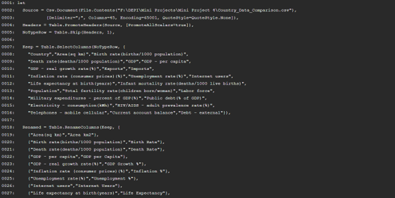

# Global Country Development Dashboard


## 1. Overview

This is a Power BI dashboard for an international economic organization that wants to follow development, economic and health indicators across countries. Everything comes from one file, *Country Data Comparison.csv*, which ends up with 237 countries and territories. I used Power BI Desktop, Power Query (M) and DAX.

One thing to know up front: the file has no date column, so there are no time trends. Where a trend would normally go, the dashboard compares each value with the world average instead.

## 2. Data preparation

The raw file needed some work before it was usable.

- It is semicolon-delimited, and the second row holds data types (“String;double;…”) instead of data. I promoted the headers and skipped that row.
- 45 columns came in. I kept the 24 the report uses and renamed them, for example “Life expectancy at birth(years)” became Life Expectancy.
- Types are converted with the en-US culture so decimals parse the same on any regional setting.
- 14 country names were standardized so the map can find them (Burma to Myanmar, Korea South to South Korea, Swaziland to Eswatini, and so on). This is a list of old/new pairs applied with List.Accumulate.
- The “#European Union” row and rows with no population (uninhabited places like Antarctica) were removed, and duplicates were dropped on Country. 263 rows became 237.
- A custom column, Data Completeness %, shows how many of six key indicators are filled in for each country.
- Missing values stay as null. Replacing them with 0 would pull every average down, and DAX already ignores blanks.



*The start of the M query in the Advanced Editor: source, headers, skipped type row, kept columns and renames.*


*The 13 applied steps of the Countries query.*

## 3. Data model

There is one main table, Countries, plus three small helper tables: \_Measures (holds the measures), Metric Choice (GDP, Population, Life Expectancy, Internet Users) and Top N (a 3 to 20 range). The two helper tables are deliberately not connected to anything. They only feed measures through SELECTEDVALUE, which is how the Metric and Top N slicers drive the map and the ranking chart.

### Calculated columns

| Column | What it does |
| --- | --- |
| Income Group | Bands by GDP per capita: High Income from 20,000, Upper-Middle from 6,000, Lower-Middle from 1,500, otherwise Low Income. “No Data” when blank. These cut-offs are my own simplification, not official World Bank values. |
| Income Group Sort | Numbers 1 to 5 so the groups sort in a logical order. It is calculated from GDP per capita directly, because basing it on Income Group created a circular dependency. |
| Life Expectancy Band | 75+, 65-74, 55-64, Below 55 |
| Population Density | Population divided by area |
| Internet Users per 100 | Internet users relative to population |
| Natural Growth % | (Birth rate - death rate) / 10 |
| Development Score | 0 to 100. Average of the percentile ranks for GDP per capita, life expectancy and infant mortality (inverted). PERCENTRANK does not exist in DAX, so the ranks are counted with FILTER over ALL. |

### Measures (29)

- **Totals and averages:** Countries Count, Total Population, Total GDP, GDP per Capita (Weighted), Avg Life Expectancy, Avg Infant Mortality, Avg Unemployment, Avg Inflation, Avg GDP Growth %, Internet Penetration %, Trade Balance
- **Comparison with the world:** GDP Share %, Population Share %, Global Avg Life Expectancy, Global Avg Unemployment, Life Exp vs Global, High Income Countries
- **Ranking and selection:** Selected Metric Value, Rank Selected, Top N Value, Top N Flag, GDP Rank, GDP Rank Global
- **Titles and formatting:** Selected Country, Dynamic Title, LE Status Color, Growth Arrow, Growth Arrow Color, Trade Balance Color

GDP per Capita (Weighted) divides total GDP by the population of only those countries that actually have a GDP figure, so missing data does not distort it.


*Measures in the \_Measures table (left) and the Countries columns, calculated ones included (right).*

Three measures that carry most of the interactivity:

```
Selected Metric Value =
SWITCH(SELECTEDVALUE('Metric Choice'[Metric], "GDP"),
  "GDP", [Total GDP],
  "Population", [Total Population],
  "Life Expectancy", [Avg Life Expectancy],
  "Internet Users", SUM(Countries[Internet Users]))

Top N Flag = IF([Rank Selected] <= [Top N Value], 1, 0)

Dynamic Title =
"Economic Overview - " & [Selected Country] & " | "
  & FORMAT([Countries Count], "#,0") & " countries"
```

## 4. Report pages

The report uses a custom dark teal theme (JSON) and a 1280 x 720 canvas.

| Page | What is on it |
| --- | --- |
| Summary | Filters for Income Group, Metric and Top N. Four KPI cards: population 6.45bn, GDP 55.64T, life expectancy 67.65, unemployment 15.28. Below them: GDP by income group, a summary matrix, the top-countries ranking, a population share donut, the top 5 countries by GDP growth, and a scatter of income against life expectancy. The Analysis I and II buttons swap the growth table and the scatter. |
| Country Analysis | Map coloured by the selected metric, top 8 exporters against imports, trade balance by income group, and an economic indicators matrix. |
| Comparison | A searchable multi-select country list, a comparison chart for the selected metric, and a detailed table with data bars, icons and colour scales. |
| Credits | Project and data information. |
| Country Detail (hidden) | Drill-through page: KPIs, GDP rank, a gauge against the world average, development score, internet penetration and an indicator table. |
| Tooltip (hidden) | Small hover card with name, population, GDP and life expectancy. |

### Screenshots


*Summary page, with the Analysis I view (scatter) selected.*


*Country Analysis: map, exporters against importers, trade balance and the economic matrix.*


*Comparison page. The detailed table carries the data bars, icons and colour scale.*


*Country Detail, opened by drill-through from China.*


*The Tooltip page showing when hovering over Egypt on the map.*

## 5. Interactivity

- **Drill-through:** right-click a country in a visual such as the Comparison chart and choose Drill through, then Country Detail. The Back button returns to the previous page.
- **Tooltips:** the Tooltip page appears when hovering over the map, the exporters chart and the comparison chart.
- **Bookmarks:** Reset (restores the default slicers), Analysis I and Analysis II (swap two visuals without touching the slicers).
- **Synced slicers:** Income Group and Metric stay the same across Summary, Country Analysis and Comparison.
- **Dynamic title:** the map title follows the selection, for example “Economic Overview - All Countries | 237 countries”.
- **Conditional formatting:** data bars on GDP, icons on life expectancy (under 65 red, 65 to 75 amber, 75 and above green) and a colour scale on unemployment in the Comparison table; coloured growth arrows; negative trade balance shown in red; a gradient on the map.
- **Navigation:** buttons on every page, with the current page highlighted.

## 6. Performance

I recorded the Summary page (21 visuals including buttons and slicers) with Performance Analyzer. The export is saved as PowerBIPerformanceData.json.

| Visual | Time |
| --- | --- |
| Top 5 countries by GDP growth (table) | 439 ms |
| Business overview (matrix) | 427 ms |
| GDP by income group | 290 ms |
| Top countries ranking | 289 ms |
| Population share donut | 287 ms |
| KPI cards | 201 to 253 ms |
| Income vs life expectancy scatter | 245 ms |
| Buttons, slicers, text box | 124 to 141 ms |


*Performance Analyzer results for the Summary page.*

Nothing took longer than half a second. What helped:

- 21 unused columns were removed in Power Query and every column has the right data type.
- Auto date/time is turned off, so there are no hidden date tables.
- Top N filters keep the ranking and growth visuals small.
- Measures are used for anything that changes with filters, and columns only for fixed groupings.
- Each page stays at about ten visuals or fewer.

## 7. Requirements check

| Requirement | Where it is |
| --- | --- |
| Advanced cleaning with Power Query and M | Section 2 |
| Calculated columns and advanced DAX | 7 columns, 29 measures |
| At least 10 DAX measures | 29 |
| At least 3 pages | 4 visible pages plus 2 hidden |
| KPI cards and dynamic titles | Summary cards, map title |
| At least 8 visuals | 10 on Summary alone, 29 across the report |
| Drill-through, bookmarks, tooltips | Country Detail, three bookmarks, Tooltip page |
| Geographical visuals and country comparison | Map and Comparison page |
| Conditional formatting and interactive filtering | Section 5 |
| Performance optimization | Section 6 |

## 8. Limitations

- No dates in the data, so no trend lines.
- World population in the file adds up to about 6.45 billion, so it looks like an older snapshot. I used the numbers as given.
- The income group thresholds are my own, as noted above.
- Eight territories have no economic data and appear under No Data.
- The map uses the Azure Maps visual because the older Filled map visual is being retired.
